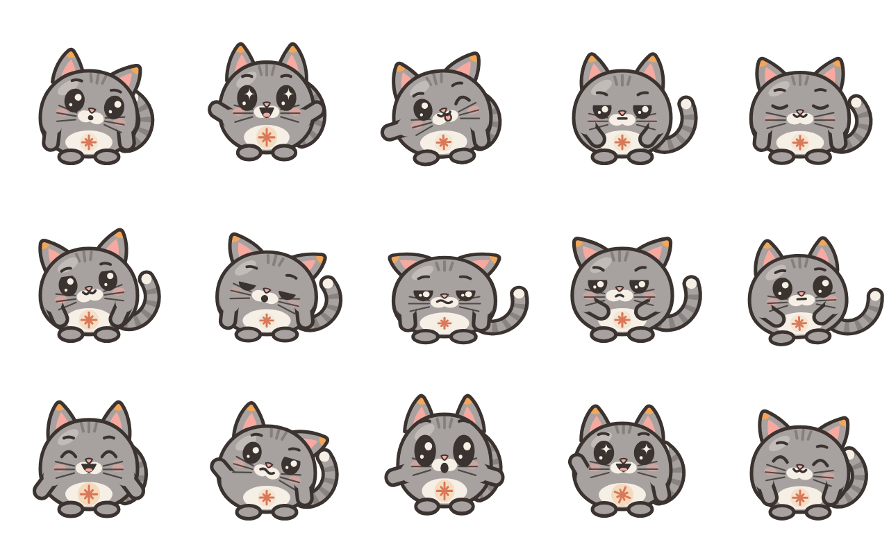
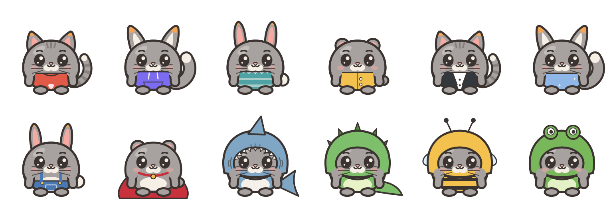
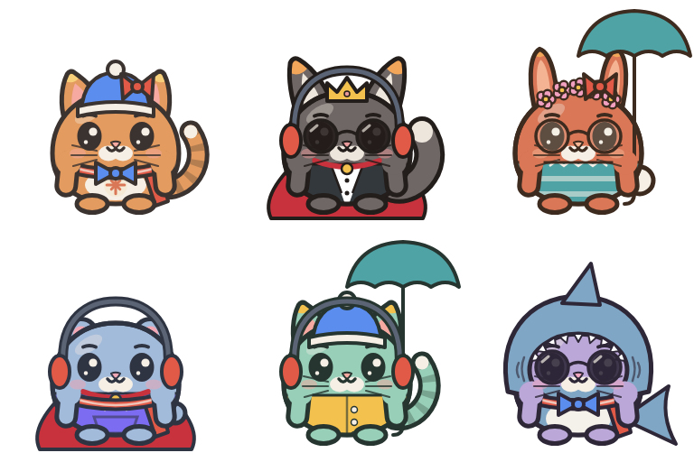
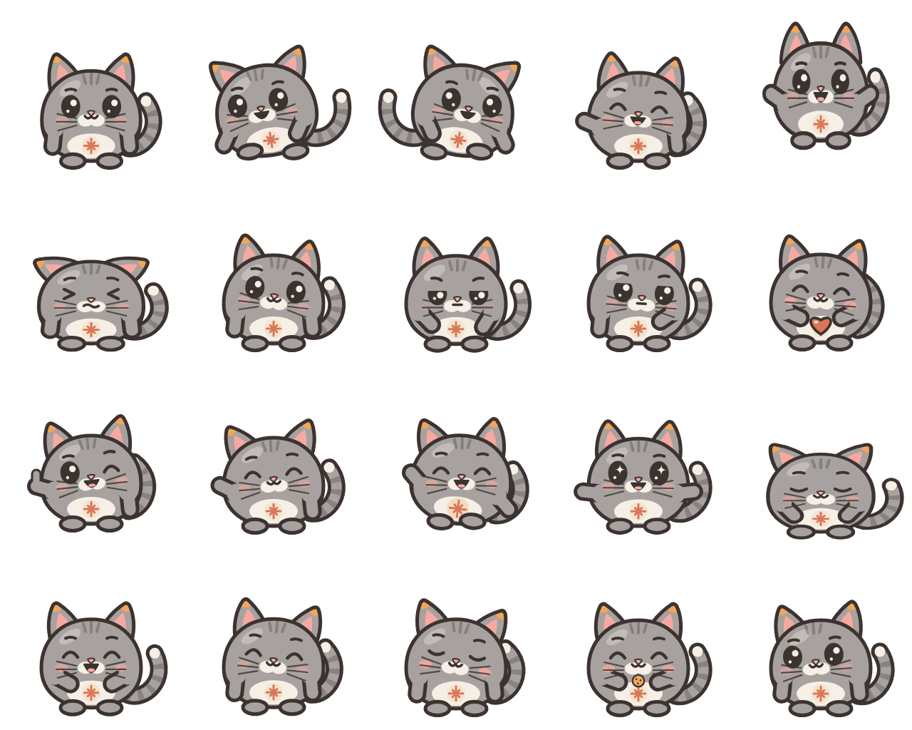
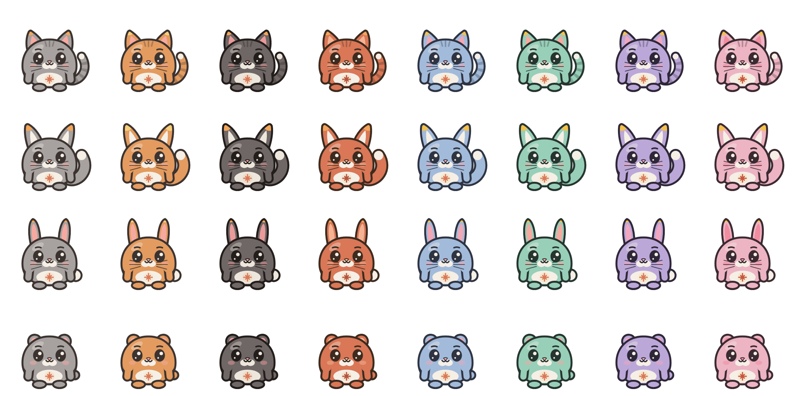
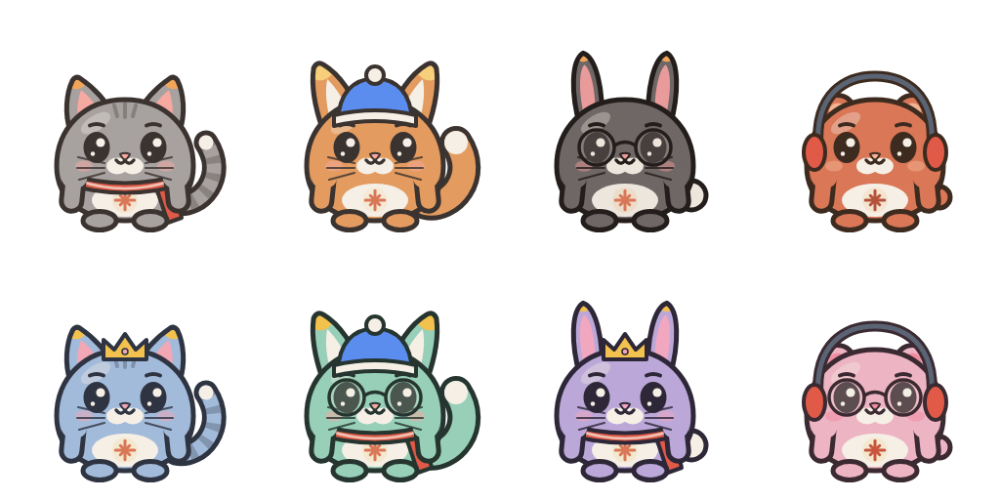

# Кай — кот-компаньон на рабочем столе

[](https://github.com/Shoxiazam/kai-pet/actions/workflows/tests.yml)

Маленький серый кот, который живёт в углу экрана: дышит, моргает, следит за курсором, радуется,
когда вы возвращаетесь, засыпает, когда вас долго нет, и показывает жесты по просьбе.



## Возможности
- **Эмоции по тому, что вы делаете:** YouTube и музыка — игривость, игры — воодушевление, мессенджеры —
  любопытство, редактор кода и офис — сосредоточенность, браузер — спокойствие. Таблица настраивается.
- **Ритм дня:** после часа работы иногда устаёт и мягко предлагает перерыв, после перерыва здоровается,
  ночью сонный, утром бодрый, без мыши и клавиатуры 10 минут — сам ложится спать в кроватку.
- **Курсор:** подвели мышь — следит за ней глазами в любую сторону (16 направлений, ближе — смотрит чуть-чуть),
  навели на Кая — любопытство.
- **Жесты и команды:** правый клик → «Сказать Каю…» или «Жесты».
  «Передай Антону привет» → облачко «Антон, привет!» и взмах лапкой; «попрощайся с Машей» → «Пока, Маша!»;
  «покажи сердечко», «покажи лайк», «покажи какой-нибудь жест», «станцуй», «обними», «поклонись», «похлопай»,
  «прыгни», «подмигни», «удивись», «поворчи», «иди спать» и другие.
- **Облачко-реплика** с кнопками «Да/Нет» — для подключения к своему ассистенту (см. ниже).
- **Музыка:** танцует только под музыку. Кай смотрит, какая программа звучит: Spotify, Яндекс Музыка, AIMP и другие
  плееры — танцует; звонки, игры, системные звуки — нет; браузер и видеоплеер — только если ролик похож на песню
  (music, клип, lyrics, «Исполнитель - Песня») и звук ровный, без пауз речи. Обзоры, подкасты и уроки — не танцует.
  Танец — по настроению музыки: грустная, спокойная, классика, рок, рэп, электроника, весёлая, энергичная —
  11 танцев (покачивание, вальс, диско, хип-хоп, робот, гитара, хлопки…), внутри настроения сменяются.
- **Погладить и угостить:** поводите мышкой по Каю — замурлычет и зажмурится. Раз в день — печенька
  (правый клик → «Угостить печенькой»). Дружба растёт сердечками, в меню видно, сколько дней вы вместе.
- **Сезоны:** зимой сам надевает шапочку и шарфик, в ваш день рождения — корону (`birthday` в настройках).
  Сняли сезонную вещь — до конца сезона Кай её не наденет.
- **Звуки:** тихое «мяу» на клик, мурчание, хруст печеньки. Выключаются в меню «Настройки».
- **Где сидеть:** в углу, сверху на активном окне (ездит вместе с ним) или где оставите. Отпустите Кая на любом
  окне — он держится за это место окна: окно двигают — едет с ним, сворачивают — прячется, закрывают — остаётся.
  На рабочем столе сидит, где оставили, у края экрана прилипает и ложится лапками к краю. **Повернуть:** меню «Повернуть» или Ctrl + колёсико мыши.
- Клик — машет, перетаскивание — переставить, правый клик — меню, значок у часов — показать/спрятать.
- **Гардероб:** правый клик → «Внешность» или словами в «Сказать Каю…». Вид: котик, лисёнок, зайка, мишка.
  Цвет: серый, рыжий, графитовый, терракотовый, голубой, мятный, сиреневый, розовый. Аксессуары: шарфик,
  шапочка, очки, наушники, корона, бантик, венок, бабочка, зонтик. «Надень шарф», «стань рыжим», «стань лисёнком»,
  «сними очки», «переоденься», «верни как было». Новый образ рисуется сам примерно за 20 секунд
  (нужны Node 22+ и Edge или Chrome), потом надевается мгновенно; хранятся 6 последних образов.
- **Мини-игры:** правый клик → «Поиграть» или словами «давай в прятки», «догони меня», «сыграем в камень-ножницы-бумага».
  *Прятки* — Кай прячется за одним из окон, из-за края торчат только ушки; найдите и щёлкните (через 15 с ушки
  шевелятся, через 90 с Кай вылезает сам). *Догонялки* — Кай убегает от курсора, поймайте его щелчком за 20 секунд.
  *Камень-ножницы-бумага* — с ведением счёта. Победы растят дружбу (не больше 6 очков в день).
- **Кай-сторож:** правый клик → «Сторожить ноутбук» или «посторожи, я ухожу». Через 20 секунд Кай начинает следить:
  кто-то тронул мышь или клавиатуру — пугается, фотографирует с веб-камеры (папка «Изображения/Кай-сторож»,
  хранятся 30 последних снимков) и подаёт сигнал `pet.guard.alarm(путь)`. С голосовым агентом и пультом «Мой ноут»
  тревога с фото приходит на телефон, а охрану можно включить и снять прямо с телефона. Пока работает ваш ассистент
  или вы управляете ноутбуком с пульта, сторож это касанием не считает. «Сними охрану» / «я вернулся» — снять.
  Вернувшись, снимите охрану с телефона — иначе Кай сфотографирует и вас.
- **Друг Кая:** правый клик → «Друг Кая»: лисичка Мира (озорная), мишка Тоша (умник-миротворец) или зайка Буня
  (весёлая). Друг садится рядом, болтает с Каем, играет, ссорится и мирится, засыпает и танцует вместе с ним.
  Словами: «позови Миру», «отпусти друга домой». Первый приход рисуется ~20 секунд (как новый образ).
- **Табличка:** правый клик → «Табличка…» — Кай держит табличку с вашим текстом («Не беспокоить», «Ушёл на обед»).
  Или словами: «покажи табличку: Привет!», «убери табличку».
- **Живёт своей жизнью:** когда ничего не происходит, раз в несколько минут сам умывается лапкой, гоняется
  за хвостом, потягивается или зевает (ночью — чаще зевает).
- **Доброе утро:** первый раз за день потягивается и здоровается: «Доброе утро! +5°, дождь — возьми зонт».
- **Скучает:** если сутки не гладили и не угощали, грустит и просит внимания, а погладили — радуется с сердечком.
- **Награды за дружбу:** на 2-м сердечке открывается бантик, на 3-м — бабочка, на 4-м — венок.
  Закрытые вещи видны во «Внешности» серыми.
- **Праздники:** на Новый год вокруг Кая падает снег, на Хэллоуин рядом тыква, в день рождения — торт со свечкой
  (выключаются вместе с сезонными образами).
- **Мяу-голос:** свои реплики Кай «проговаривает» коротким мурлыкающим бормотанием, как в играх. Ответы
  вашего ассистента (метод `say`) звучат без него.
- **Фокус:** правый клик → «Фокус 25 минут» или словами «фокус на 40 минут» — Кай держит табличку с таймером,
  а если во время фокуса впереди YouTube, соцсети или Twitch — хмурится и зовёт обратно. В конце хлопает.
- **Глаза 20-20-20:** каждые 20 минут работы Кай закрывает глаза и просит 20 секунд посмотреть вдаль.
- **Заметка на окне:** прикрепите Кая к окну → «Заметка на это окно…» — табличка висит, пока Кай держится
  за окно («Сдать отчёт до 18:00» на Excel), и уходит вместе с окном.
- **Батарея и нагрузка:** ниже 15% без зарядки Кай засыпает на ходу и просит зарядку, на зарядке мурлычет;
  когда процессор загружен больше 85% полминуты — обмахивается: «жарко».
- **Отчёт за день:** «Отчёт за сегодня» в меню, а вечером Кай сам скажет: «Сегодня за компьютером 6 ч:
  VS Code 3 ч, Chrome 2 ч…». Считаются только имена программ, хранится неделя и только на компьютере
  (`~/.kai-pet-usage.json`).
- **По погоде:** меню «Погода» → «Указать город…» — раз в 30 минут Кай смотрит погоду и сам одевается: холодно —
  шапка и шарф, прохладно — шарф, дождь — зонтик, жара и солнце — тёмные очки. Снимете погодную вещь — сегодня
  без них.
- **Одежда и костюмы:** «Внешность» → «Одежда»: футболка, худи, свитер, дождевик, смокинг, пижама,
  комбинезон, плащ героя. «Костюмы» — кигуруми целиком, с капюшоном: акулёнок (плавник, зубки, хвост),
  динозаврик, пчёлка, лягушонок. Костюм заменяет шапку и одежду, очки и шарф можно оставить.
  Словами: «надень худи», «надень костюм акулы», «стань пчёлкой».

  
- **Сочетания:** вещи надеваются вместе — шапка с бантиком и наушниками, шарф с бабочкой, худи с плащом героя,
  очки с зонтиком. Меняются местами только те, что лезут на одно место: шапка, корона и венок; очки и тёмные очки;
  одна одежда. Свои SVG из папки сочетаются со всем.

  
- **Свои вещи:** «Внешность» → «Аксессуары» → «Свои вещи (папка)…» откроет папку
  (`%LOCALAPPDATA%\KaiPet\accessories`, или задайте `KAI_ACCESSORIES`). Положите туда любой SVG, хоть скачанный:
  Кай сам уберёт белый фон и подпись в углу, уменьшит рисунок и поставит на место. Имя — `место-название.svg`:
  `head-…` на голову (без места — тоже на голову), `neck-…` на шею, `face-…` на лицо, `hand-…` в лапку.
  Рисунок, сделанный под Кая (viewBox 0 0 256 256, голова около 128,120), не подгоняется. Вещь сразу появится в меню. Пример — [examples/accessories/head-bow.svg](examples/accessories/head-bow.svg).
  Поправили рисунок — переименуйте файл: готовые образы запоминаются по имени.
- **Охота за мышкой:** быстро потрясите курсором рядом с Каем — он подбежит (если сидит «где оставлю») и прыгнет.
  Выключается в «Настройках».







## Приватность
Всё считается на компьютере. Кай знает только имя программы, заголовок и место окна впереди, сколько секунд
не было ввода и насколько громко сейчас играет звук (не что именно). Что вы печатаете, он не видит, скриншотов не делает.
В сеть Кай ходит только за погодой, и только если вы указали город: название города и координаты уходят
в [Open-Meteo](https://open-meteo.com) (без ключа и регистрации). Без города — в сеть ничего не отправляет.

## Скачать
Готовый **KaiPet.exe** для Windows — в [Releases](https://github.com/Shoxiazam/kai-pet/releases):
скачайте и запустите, Python не нужен. Значок Кая появится у часов, там же — «Запускать вместе с Windows».
Для новых образов из гардероба нужен [Node.js](https://nodejs.org) (Edge в Windows уже есть).

## Установка из исходников
Нужен Python 3.10+.

```bash
pip install -r requirements.txt
python -m kai_pet
```
Или двойной щелчок по `run_kai.pyw`.

Эмоции по программам и время без ввода работают на Windows. На macOS и Linux Кай тоже запускается, но эти
сигналы молчат: остаются курсор, жесты, команды и время суток.

## Настройки
Необязательный файл `~/.kai-pet.json` (или путь в переменной `KAI_PET_CONFIG`):

```json
{
  "size": 150,
  "sleep_after_min": 10,
  "tired_after_min": 60,
  "hints": true,
  "sounds": true,
  "dance_to_music": true,
  "seasonal": true,
  "birthday": "03-21",
  "moods": {"figma": "inspired", "youtube": "playful", "code.exe": "focused"}
}
```

`moods` — кусок имени программы или заголовка окна → эмоция, первое совпадение побеждает. Эмоции:
`curious excited playful focused calm caring sleepy tired grumpy cautious proud confused surprised inspired supportive`.
Все ключи — в [kai_pet/config.py](kai_pet/config.py).

Образ Кая запоминается в `~/.kai-pet-state.json` (путь меняется переменной `KAI_PET_STATE`).

## Подключение к своему ассистенту
```python
from kai_pet import Pet

pet = Pet()
pet.show()
pet.set_status("working")          # idle | working | waiting
pet.hear("открой почту")           # что сказал пользователь
pet.done("Готово, открыл почту")   # кивнёт и ненадолго гордится
pet.failed()                       # огорчится
pet.say("Привет!")                 # облачко
pet.ask("Отправить письмо?")       # облачко с «Да/Нет» → сигнал pet.bubble.answered(bool)
pet.gesture("heart")               # heart like wave bye dance hug bow clap jump или любая эмоция
pet.command("передай Антону привет")  # True, если фраза для Кая
pet.change_look({"wear": "scarf"})    # kind / color / wear / remove / reset / random
```

## Персонаж
Кай нарисован кодом: [character/kai.js](character/kai.js) — SVG со слоями (тело, ушки, хвост, глаза, брови,
рот, лапки, лучистый знак на груди), состояния и анимации вызываются по имени, палитра задаётся в одном месте
(`PALETTE`) или CSS-переменными `--kai-*`. Превью в браузере — [character/index.html](character/index.html)
(откройте через любой локальный сервер, например `python -m http.server`).

Готовые кадры уже лежат в `assets/`. Если поменяли персонажа — пересоберите их (нужны Node 22+ и Edge или Chrome):

```bash
node character/test.mjs
node character/export.mjs
```

## Сборка KaiPet.exe
```bash
pip install pyinstaller
python build_exe.py
```
Готовый файл — `dist/KaiPet.exe`. На GitHub это делает сам: `git tag v1.2.0 && git push origin v1.2.0` —
через несколько минут `.exe` появится в Releases.

## Проверки
```bash
pip install -r requirements-dev.txt
python -m pytest -q
```

## Лицензия
MIT — см. [LICENSE](LICENSE). Персонаж Кай оригинальный и распространяется на тех же условиях.

---

**Kai** is a small desktop cat companion (Python + PySide6). It reacts to the app in front, your work rhythm,
the cursor and simple Russian commands like «покажи сердечко» (show a heart). Everything runs locally; it never
reads keystrokes or the screen. Run: `pip install -r requirements.txt && python -m kai_pet`.
